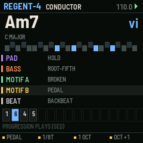
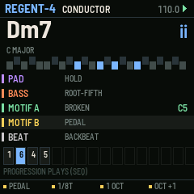
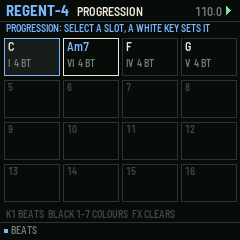
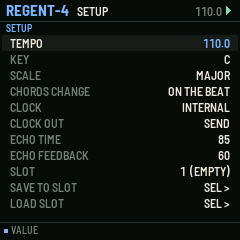

# REGENT-4

Play chords; four parts follow them. For the M-VAVE FM-1. One of six sequencer firmwares built from a survey of sequencer archetypes (see the companion survey). Built on fm1-base; makes its own sound and sends MIDI.

## What it is for

**Archetype:** Harmonic conductor: Conductive Labs NDLR, chord tracks, Orba-style parts.

REGENT-4 lets someone who thinks in harmony make a whole arrangement from chord changes. The white
keys are the degrees of the key, so every chord is in key, and the black keys colour it (7th, sus2, sus4, add9, 6th,
major/minor flipped, flat five). A pad voice-leads through the changes, a bass plays a figure from the root, two
motifs arpeggiate the chord at their own rates, and a beat runs under them. A progression is recorded simply by
playing it with REC, then plays back with SEQ while you play over it or change key.

## What it does

- White keys 1-14: chords on degrees I-VII and an octave up; white 15: no chord; white 16: tap tempo.
- Black keys 1-7 held with a chord key (or pressed while one is held): 7, sus2, sus4, add9, 6, flip, b5. Black keys 8-11 mute the parts.
- PAD (hold, quarters, eighths, on change; voice-led, spread), BASS (8 figures), MOTIF A and B (12 figures + dice, 6 rates, 1-3 octaves), BEAT (6 grooves, fills before a change).
- Chords change at once, on the beat or at the bar; the next chord is shown while it waits.
- PROGRESSION of 16 chords with beats each: recorded by playing (REC), edited on its page (EDIT), played by SEQ.
- PRESETS changes key on the fly (SEL + PRESETS the scale). MIDI notes in choose the chord on that root.
- The chord's name (Am7, Fsus4) and numeral (vi, IV) large on the screen; the pad's voicing on a keyboard picture.

## The controls

Hold any button alone for a second for its help card on the screen.

| Control | What it does |
| --- | --- |
| white keys 1-14 | chords on the degrees |
| black keys 1-7 | colours |
| black keys 8-11 | mute PAD, BASS, MOTIF A, MOTIF B |
| white 15 / FX | no chord |
| white 16 | tap tempo |
| ALGO | the part; K1-K4 its four (figure, rate / octave, range / gate / spread, level) |
| PRESETS / SEL + PRESETS | key root / scale |
| SELECT | tempo |
| REC | record a progression by playing |
| SEQ | the progression plays |
| EDIT | the progression page |
| ARP | dice a motif |
| LFO | mute the part |
| OCT | the part's octave |

Common to all six: PLAY starts and stops, SAVE saves to the project slot, OCT- / OCT+ the octave.

## Screens

   

## Build, test, install

The firmware is built with [fm1-base](https://github.com/charlesvestal/fm1-base) (vendored in `base/`) and JieLi's
toolchain, which runs in Docker on macOS (`colima start` first). Python 3.11 with Pillow.

    ./build.sh --host              # the host simulator, then every test in app/tests/
    ./build.sh --shots             # the screenshots in app/docs/img/
    ./build.sh                     # a development package: app/build/regent-4.fwsc
    ./build.sh --release 0.1       # a release package: app/build/regent-4-0.1.fwsc

Install over USB with fm1-base's installer (the FM-1 connected, Python with `python-rtmidi`):

    python3.11 base/tools/fm1_install.py app/build/regent-4-0.1.fwsc

Keep M-VAVE's stock firmware and M-UPGRADE at hand: the installer can put the stock firmware back.

## Layout

| Path | What |
| --- | --- |
| `app/seq.c` | the sequencer: its data and the engine (runs inside the audio render, sample-exact) |
| `app/ui.c` | the controls and the screen |
| `app/app.c`, `app/app.h` | the contract with fm1-base |
| `app/core/` | shared with the five sibling firmwares: synth (8 voices, 11 drums, echo), transport and MIDI clock, project slots, controls kit, text |
| `app/tests/` | host-simulator scripts: `basic.txt` (behaviour) and `screens.txt` (pictures) |
| `app/fm1.toml` | build settings, package identity `FM-1_24`, firmware.json fields |
| `base/` | fm1-base and felucca-bsp, vendored (MPL-2.0) |

## Common to all six

- Its own sound: an 8-voice synth (saw, square, triangle, sine, noise, super-saw; resonant filter; ADSR; glide),
  eleven synthesised drums on General MIDI notes, and a shared echo. Every part also goes out as MIDI (its channel set
  on its sound page) over USB and Bluetooth MIDI.
- MIDI clock: INTERNAL (and send clock, start, stop) or FOLLOW an incoming clock. MIDI notes in play the part shown.
- Four project slots (SETUP / GLO page). SAVE while playing saves at the stop.
- Hold any button alone for a second: a help card explains it.

## Status

**0.1, untested on hardware.** It builds for the FM-1, passes its host-simulator tests, and its screens are taken
from the simulator. Nothing has been run on a real FM-1 yet; CPU load of the synth on the device is not measured.

## Licence

MPL-2.0, as fm1-base. After the Conductive Labs NDLR and the chord tracks of Logic and Cubase.
